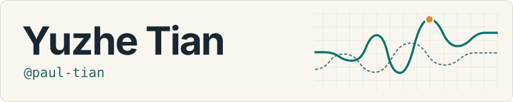
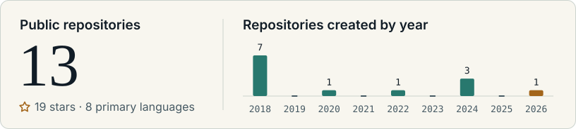

Hi, I’m Paul. I build macOS tools, work with motion sensors, and study how neural networks hold up after compression. I also keep a [personal blog](https://paul-tian.github.io/).

### Selected projects

| Project | What’s inside |
| --- | --- |
| [Apple Pickup Monitor](https://github.com/paul-tian/apple-pickup-monitor) | A SwiftUI app with a Rust monitoring engine that notifies you when a product is available for pickup at an Apple Store. |
| [JY901 on Arduino](https://github.com/paul-tian/Arduino-JY901-Serial) | Read motion data from a JY901 sensor over serial and send configuration commands back from an Arduino MKR board. |
| [Model pruning and quantization](https://github.com/paul-tian/broadnet2022-compression) | The PyTorch experiments behind our BroadNet 2022 paper on pruning and quantization. |

<picture>
  <source media="(prefers-color-scheme: dark)" srcset="./assets/contributions-dark.svg">
  
</picture>

<picture>
  <source media="(prefers-color-scheme: dark)" srcset="./assets/activity-dark.svg">
  
</picture>
